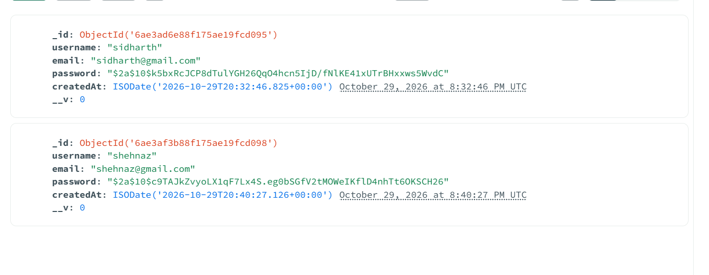

# Sign Up Application - MERN task2

A simple user registration application built with the MERN stack (MongoDB, Express, React, Node.js)

## Project Screenshots

### Sign Up Page


### After Creating User


### User Already Exists


### Database View


## Project Structure
```
task2/
├── backend/
│   ├── models/
│   │   └── User.js          # User Schema
│   ├── routes/
│   │   └── auth.js           # Authentication Routes
│   ├── server.js             # Express Server
│   ├── .env                  # Environment Variables
│   └── package.json
└── frontend/
    ├── src/
    │   ├── components/
    │   │   └── SignUp.jsx    # Sign Up Component
    │   ├── App.jsx           # Main App Component
    │   ├── App.css           # Global Styles
    │   └── main.ts           # Entry Point
    └── package.json
```

## Prerequisites
- Node.js installed
- MongoDB running on localhost:27017

## Installation & Setup

### Backend Setup
1. Navigate to the backend directory:
```bash
cd backend
```

2. Install dependencies:
```bash
npm install
```

3. Configure MongoDB connection in `.env` (default is already set):
```
MONGODB_URI=mongodb://localhost:27017/signup-app
PORT=5000
```

4. Start the backend server:
```bash
npm start
```

The backend will run on http://localhost:5000

### Frontend Setup
1. Navigate to the frontend directory:
```bash
cd frontend
```

2. Install dependencies:
```bash
npm install
```

3. Start the development server:
```bash
npm run dev
```

The frontend will run on http://localhost:5173 (or the port shown in terminal)

## Features
- User registration with username, email, and password
- Password hashing using bcryptjs
- MongoDB database storage
- Form validation
- User-friendly error and success messages

## API Endpoints

### POST /api/auth/signup
Registers a new user.

**Request Body:**
```json
{
  "username": "johndoe",
  "email": "john@example.com",
  "password": "password123"
}
```

**Success Response (201):**
```json
{
  "message": "User created successfully",
  "user": {
    "username": "johndoe",
    "email": "john@example.com"
  }
}
```

**Error Response (400):**
```json
{
  "message": "User already exists"
}
```

## Usage
1. Make sure MongoDB is running
2. Start the backend server in one terminal
3. Start the frontend server in another terminal
4. Open the frontend URL in your browser
5. Fill out the sign-up form and submit
6. Check the database to verify user creation
